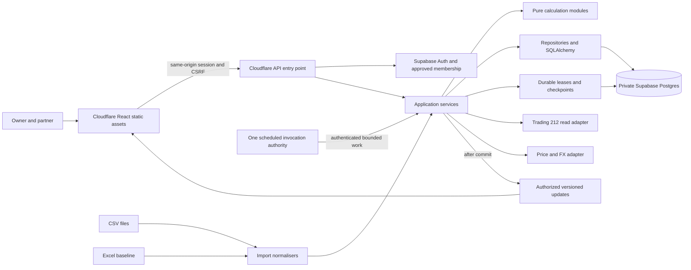

# Architecture

Status: **CONFIRMED production platform change, 11 November 2026**. The owner selected Cloudflare + Supabase, replacing production SQLite and a continuously running APScheduler process. Preserve Python/FastAPI where a measured runtime spike passes. [ADR 0001](decisions/0001-cloudflare-supabase.md) records the decision, superseded assumptions and outstanding gates.

**Implemented state includes local evidence tooling, broker observation adapters and verified PostgreSQL schema parity.** The closed, empty evidence bootstrap is deployed to the dedicated Supabase project through native GitHub migrations. There is no deployed application API, hosted authentication, scheduled jobs, frontend or analytics; see the [current handoff](status-and-handoff.md) for exact verified slices.

## Choose the smallest system that can be checked

Keep a modular application: React static assets on Cloudflare, an API under the same browser origin, and private Supabase Postgres persistence. Python/FastAPI on Cloudflare Workers is the first compatibility candidate, not an assertion that the current CPython process deploys unchanged. Authenticated bounded scheduled invocations replace a resident scheduler. Two equal full-editor logins share one owner's live ISA; Demo and Live evidence remain isolated. No initial role hierarchy is required; tax remains a later optional extension.

Hosted synthetic checks now show that ordinary Python/FastAPI and native Python HTTP controls exceed the documented ordinary Free CPU budget for the same probe. A thin JavaScript gateway to a Python Durable Object passed the same synthetic response contract with separate stateless/object CPU traces. [ADR 0003](decisions/0003-python-object-qualification.md) selects that path for further qualification only. It preserves Python calculations and Supabase application persistence; the controls are not the production Auth boundary or proof of capacity/recovery.

Qualify hosting before building further SQLite-specific production features: exact Decimal persistence, atomic imports, private access, dependency compatibility, representative analytics, job recovery, storage budgets and restore must pass. Use synthetic data first. The owner selected the platform; a TypeScript backend rewrite, reduced polling/retention or an unmeasured claim that every calculation fits free compute is not implied. The [hosting review](hosting-options.md) records current published budgets and candidate alternatives.

This scale does not justify distributed jobs, microservices, Redis, event sourcing of every internal operation or a generic provider plugin registry. Preserve immutable financial evidence and audit without turning every read model into an event-stream platform.



## Dependency rules

| Layer | Owns | Must not own |
| --- | --- | --- |
| Domain/calculations | Typed inputs, formulas, matching, quality rules, deterministic results | HTTP requests, database sessions, provider SDKs, UI formatting |
| Application services | Use cases, source selection, job orchestration, transaction boundaries, audit calls | Duplicated financial formulas or endpoint-specific response parsing |
| Adapters | Broker, CSV, Excel, market data and calendars; normalised contracts | Tax matching, portfolio-return policy or group decisions |
| Persistence | Models, migrations, constraints, repositories and cached read models | Hidden changes to imported economic meaning |
| API | Validation, authentication, authorisation, error mapping and serialisation | Direct provider calls from handlers or alternative formulas |
| Frontend | Presentation, filtering, scenario input and quality explanations | Secrets, authoritative returns, tax or covariance calculations |

Keep interfaces narrow and concrete. Begin with the one required implementation; add abstraction only at actual external-provider boundaries. Prefer ordinary functions and typed data structures over inheritance hierarchies.

## Authoritative data and derived views

1. Raw source evidence and normalised economic events are durable.
2. Cash and quantities are replayed from supported events and explicit opening records.
3. Broker position snapshots reconcile against the replay; they are not additional buys.
4. Price/FX observations and their revisions are durable evidence.
5. Valuations, analytical results and tax allocations are derived, versioned and reproducible.
6. Excel baseline snapshots remain separately identified. They do not manufacture events or fill missing daily returns.

An account can show broker-observed current positions before history is complete, but the UI must label this view and suppress unsupported historical/tax results. Never add broker-observed quantities to ledger-derived quantities.

## Runtime and concurrency

- Worker instances are disposable and can run concurrently. FastAPI lifespan may manage request/runtime resources after compatibility verification; it must not start an always-on scheduler. Threads, filesystem durability and ordinary CPython/native package support are not assumed in Workers.
- Select **one** scheduling authority during the hosting spike: Cloudflare scheduled entry points or Supabase Cron invoking a protected bounded endpoint. Do not enable both for the same family. Manual refresh uses the same persisted job/rate state.
- Store job identity, status, lease owner/expiry, retry-not-before, provider rate-reset state, attempt count and checkpoints in Postgres. Acquire/renew a bounded lease atomically; stale owners cannot commit a newer generation after another owner takes over. Leases limit active work without pretending that network delivery is exactly once.
- Each invocation does bounded work, commits its progress and returns. Persist continuation and retry time for a later invocation; do not sleep across worker lifetimes or rely on in-memory timers, locks or counters for correctness. The offline broker adapter's in-process pacing is insufficient by itself for production concurrency.
- Do not share ORM sessions across invocations. Fetch and validate external data outside short write transactions. Use real Postgres transactions for financial commits; multiple HTTP Data API calls are not one transaction. Stage a complete accepted sync generation before making it visible; failed later pages do not advance its accepted checkpoint.
- Choose and measure the Postgres driver/connection path. Current Cloudflare documentation supports Python Hyperdrive with synchronous SQLAlchemy, while async ORM lacks greenlet support. Use least-privilege database roles and transaction-local authorization where needed; prove pooling never leaks a prior user's context. Do not use query caching for session/authorization checks or mutable financial freshness without a separately correct policy.
- CPU-intensive imports/analytics are bounded jobs rather than request-handler loops. Qualify actual package versions, memory and CPU, and preserve pure formula contracts. Failure to fit is a recorded implementation decision, not permission to silently move authoritative formulas into React.

The previous one-process/one-SQLite-writer model remains valid for the offline foundation and its tests. Its WAL/busy-timeout and local backup behavior are not production Postgres or multi-instance evidence.

## Proposed source layout

This is a target, not a directory tree that already exists:

```text
backend/
  pyproject.toml
  src/meridian/
    app.py
    api/                 # small route modules and DTOs
    application/         # sync, imports, valuation, group changes, queries
    domain/              # money, events, eligibility, result types
    calculations/        # returns, risk, correlation, attribution; tax later
    adapters/            # trading212, csv, excel, yfinance, calendars
    persistence/         # models, repositories, database setup
    jobs/                # bounded dispatch, database leases, backfill
    security/            # Auth integration, sessions, CSRF, membership
  migrations/            # local SQLite/Postgres Alembic history; hosted writer is supabase/migrations
  tests/                 # unit, integration, contract; synthetic fixtures
frontend/
  package.json
  src/
    app/                 # navigation and authenticated shell
    features/            # nine tabs grouped by user capability
    components/          # shared tables, formatting, quality indicators
    api/                 # generated/typed client and SSE handling
docs/
```

Do not split a three-function module into five files to match this diagram. Split when responsibilities or reviewability require it. Keep files small enough for a local model to reason about, without a rigid line-count target.

## Reproducibility and invalidation

Each computed result references a ledger revision, price/FX selection revision, group-classification revision, settings revision, method version and as-of time. Use targeted revision counters and input hashes; do not introduce a generic distributed cache.

Imports invalidate affected dates and dependent results. A late acquisition can invalidate a prior disposal's 30-day allocation. Group changes invalidate grouped views. Price revisions invalidate affected valuations and analytics. Failed recomputation does not silently replace a prior valid result; display its age and current invalidation state.

Publish only committed result versions. Authenticated SSE remains the preferred delivery contract, subject to Worker streaming/runtime tests. Authorized private Supabase Realtime batched updates are an alternative if recorded after qualification; accepting Cloudflare + Supabase does not automatically change the transport requirement. On reconnect, the frontend fetches a complete snapshot. Transport events are not the source of truth.

## Recovery and evolution

The first SQLite migration and local online-backup workflow are implemented foundations. Add reviewed Postgres migrations and enforce equivalent uniqueness, account scope, evidence immutability and transaction invariants before hosted financial imports. Preserve exact values and IDs across any SQLite-to-Postgres transfer; validate controls in a separate target database before selecting it. Schema upgrades, backfills and analytical recomputation remain separate operations.

Supabase Free lacks automatic database backups. A production gate must prove private off-host exports and restore of Postgres **and** necessary source/archive evidence. Do not treat an object archive as both the only copy and its own backup. Keep daily data indefinitely and the requested 90-day intraday history; if measured database size requires compact private archives, preserve lossless retrieval/provenance and verify the complete free-storage budget. A shorter retained history requires an explicit owner scope decision.

The former recommendation to keep production SQLite until scaling pressure is **superseded by the owner's hosted-platform decision**, rather than by an observed SQLite performance failure. Tailscale/Cloudflare Tunnel remain documented historical alternatives, not the selected hosted topology.

Sources: [Cloudflare FastAPI](https://developers.cloudflare.com/workers/languages/python/packages/fastapi/), [Python Hyperdrive and SQLAlchemy limits](https://developers.cloudflare.com/hyperdrive/examples/python-workers/), [Supabase Cron](https://supabase.com/docs/guides/cron), [Supabase free backup guidance](https://supabase.com/docs/guides/platform/backups). The [hosting review](hosting-options.md) owns dated quota details. No hosted capability test is claimed here.
