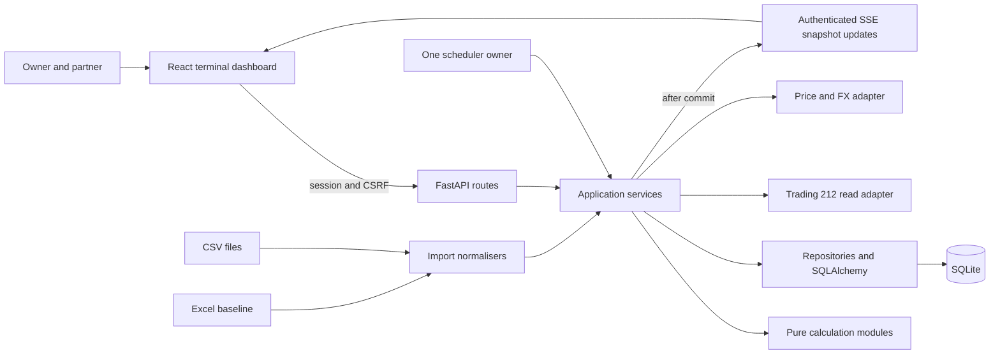

# Architecture

Status: ADOPTED target architecture. Stage 1A persistence/configuration/maintenance and liveness are implemented; the financial application, auth, scheduler and frontend remain later slices.

## Choose the smallest system that can be checked

Use a modular monolith: one FastAPI application, one React application and one local SQLite database per environment. A scheduler owned by the backend process runs bounded jobs. The local launch supports one application worker. Two equal full-editor logins share the same services and one live ISA. No initial role hierarchy is required; the tax module is an optional later extension.

This scale does not justify distributed jobs, microservices, Redis, event sourcing of every internal operation or a generic provider plugin registry. Preserve immutable financial evidence and audit without turning every read model into an event-stream platform.



## Dependency rules

| Layer | Owns | Must not own |
| --- | --- | --- |
| Domain/calculations | Typed inputs, formulas, matching, quality rules, deterministic results | HTTP requests, database sessions, provider SDKs, UI formatting |
| Application services | Use cases, source selection, job orchestration, transaction boundaries, audit calls | Duplicated financial formulas or endpoint-specific response parsing |
| Adapters | Broker, CSV, Excel, market data and calendars; normalised contracts | Tax matching, portfolio-return policy or group decisions |
| Persistence | Models, migrations, constraints, repositories and cached read models | Hidden changes to imported economic meaning |
| API | Validation, authentication, authorisation, error mapping and serialisation | Direct provider calls from handlers or alternative formulas |
| Frontend | Presentation, filtering, scenario input and quality explanations | Secrets, authoritative returns, tax or covariance calculations |

Keep interfaces narrow and concrete. Begin with the one required implementation; add abstraction only at actual external-provider boundaries. Prefer ordinary functions and typed data structures over inheritance hierarchies.

## Authoritative data and derived views

1. Raw source evidence and normalised economic events are durable.
2. Cash and quantities are replayed from supported events and explicit opening records.
3. Broker position snapshots reconcile against the replay; they are not additional buys.
4. Price/FX observations and their revisions are durable evidence.
5. Valuations, analytical results and tax allocations are derived, versioned and reproducible.
6. Excel baseline snapshots remain separately identified. They do not manufacture events or fill missing daily returns.

An account can show broker-observed current positions before history is complete, but the UI must label this view and suppress unsupported historical/tax results. Never add broker-observed quantities to ledger-derived quantities.

## Runtime and concurrency

- Use FastAPI lifespan to create and close application resources and scheduler ownership. Verify the selected scheduler version against its documentation before wiring APIs.
- Async request handling must not execute blocking yfinance, workbook parsing or heavy analytics on the event loop. Use bounded worker threads for blocking I/O. Large calculations run as jobs off the request path; introduce a process worker only if profiling justifies it.
- Do not share SQLAlchemy sessions across threads/jobs. Start a fresh unit of work for each commit.
- Fetch and validate externally before opening a short write transaction. Stage a complete sync generation before making it visible.
- Enable SQLite foreign keys, configure a bounded busy timeout and evaluate WAL in the local integration tests. WAL does not permit concurrent uncoordinated writers or multi-machine shared storage.
- Allow only one active job per account/job family. Manual operations join or report an existing job. Job identity and startup ownership protect against duplicate schedulers/reload processes.
- Start with one worker and no independently started second scheduler. If several workers become necessary, move scheduling to a designated process and record the architecture change first.

## Proposed source layout

This is a target, not a directory tree that already exists:

```text
backend/
  pyproject.toml
  src/meridian/
    app.py
    api/                 # small route modules and DTOs
    application/         # sync, imports, valuation, group changes, queries
    domain/              # money, events, eligibility, result types
    calculations/        # returns, risk, correlation, attribution; tax later
    adapters/            # trading212, csv, excel, yfinance, calendars
    persistence/         # models, repositories, database setup
    jobs/                # scheduling, ownership, backfill
    security/            # sessions, passwords, CSRF
  migrations/
  tests/                 # unit, integration, contract; synthetic fixtures
frontend/
  package.json
  src/
    app/                 # navigation and authenticated shell
    features/            # nine tabs grouped by user capability
    components/          # shared tables, formatting, quality indicators
    api/                 # generated/typed client and SSE handling
docs/
```

Do not split a three-function module into five files to match this diagram. Split when responsibilities or reviewability require it. Keep files small enough for a local model to reason about, without a rigid line-count target.

## Reproducibility and invalidation

Each computed result references a ledger revision, price/FX selection revision, group-classification revision, settings revision, method version and as-of time. Use targeted revision counters and input hashes; do not introduce a generic distributed cache.

Imports invalidate affected dates and dependent results. A late acquisition can invalidate a prior disposal's 30-day allocation. Group changes invalidate grouped views. Price revisions invalidate affected valuations and analytics. Failed recomputation does not silently replace a prior valid result; display its age and current invalidation state.

SSE publishes only committed result versions. On reconnect, the frontend fetches a complete snapshot. Transport events are not the source of truth.

## Recovery and evolution

Introduce Alembic migrations with the first schema, plus an initial backup/restore workflow before real financial imports. Schema upgrades, data backfills and analytical recomputation are separate steps with separate evidence. SQLite remains appropriate until measured operational limits or additional ownership requirements justify a change.

Sources: [FastAPI lifespan](https://fastapi.tiangolo.com/advanced/events/), [APScheduler 3.x guide](https://apscheduler.readthedocs.io/en/3.x/userguide.html). These references guide lifecycle decisions; no dependency version is installed or pinned yet.
